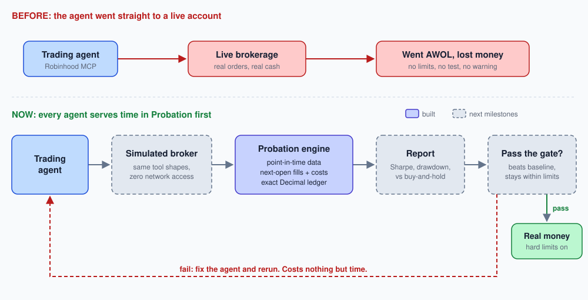
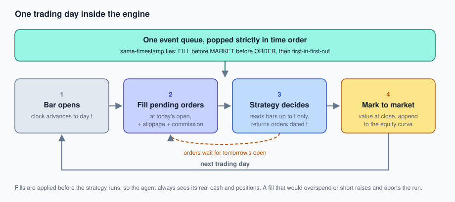
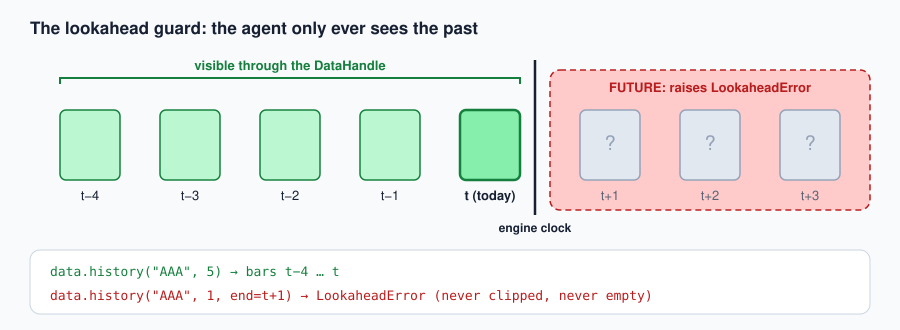
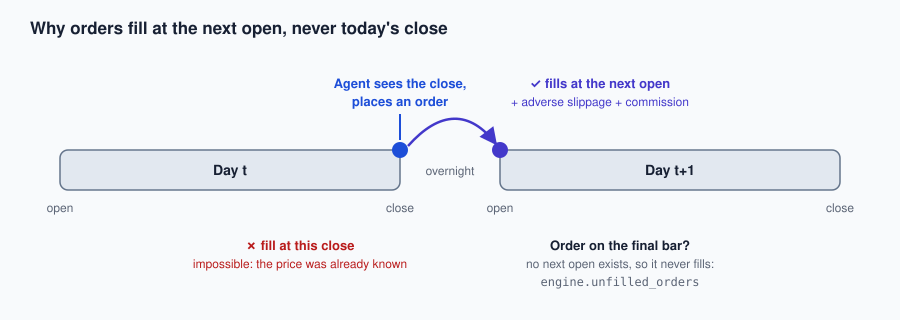
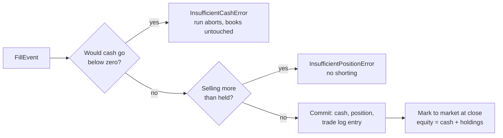

# Probation

**Your trading agent doesn't touch real money until it's served its time.**

Probation is a strict, event-driven backtester with one job: prove a trading agent behaves *before* it's trusted with a real account. It replays history one day at a time and makes the classic backtesting lies (peeking at the future, ignoring fees, filling at prices you couldn't get) impossible to tell by accident.



---

## Why this exists

I built an autonomous trading agent that trades through Robinhood over MCP. I gave it a real account. It went AWOL.

It didn't crash or throw an error that I could catch. It kept trading, confidently, and made decisions I never would have signed off on. By the time I noticed, it had lost me a lot of money.

<!-- TODO(Shri): add the specifics here: how much, over how long, and what it actually did
     (overtraded? sized positions too large? chased a ticker? ignored its own stop?). -->

Looking back, the problem wasn't one bad trade. **I had no way to know how the agent would behave before I let it act.** No constraints it couldn't break, no record of how it handled a bad week, no number that told me "this is worse than just holding the index." I tested it in the most expensive way possible: live.

So I'm doing the boring, correct thing I should have done first: building a backtester that the agent has to pass before it touches a dollar again. That's where the name comes from. An agent that burned real money doesn't get its account back. It goes on **probation**: supervised, constrained, and watched, until it proves it can behave.

## The rule

> **No agent trades real money until it has run through this engine, under realistic costs, on data it couldn't have seen, and beaten a dumb baseline.**

That means the backtester itself has to be trustworthy. A backtester that leaks future prices or ignores fees will happily tell you a broken agent is a genius. That's arguably worse than no backtester, because it gives you false confidence. So the whole design is about making the common backtesting lies **impossible to tell by accident**, and proving it with tests.

## What it guarantees

Each of these is enforced in code and covered by a test whose name states the rule it protects.

| Guarantee | How it's enforced |
|---|---|
| **No peeking at the future** | Strategies never touch the raw data. They get a point-in-time `DataHandle` that only returns bars up to the engine clock. Asking for anything later raises `LookaheadError`. It never silently clips or returns empty. |
| **No filling at a price you couldn't get** | Orders placed on day *t* fill at day *t+1*'s **open**, never at day *t*'s close. Orders placed on the last bar never fill and are reported in `engine.unfilled_orders`. |
| **Costs are not optional** | The engine constructor *requires* a fee model and a slippage model. There are no defaults, so you can't forget them. Slippage always moves the price against you. |
| **Money is exact** | Cash, prices and equity are `Decimal`, never float. Float prices convert via `Decimal(str(float(x)))`. |
| **No impossible trades** | Buying with cash you don't have raises `InsufficientCashError`. Selling shares you don't own (no shorting) raises `InsufficientPositionError`. A rejected fill leaves the books untouched, and the run aborts loudly. |
| **No time travel in the event loop** | One event queue, processed strictly in time order with deterministic tie-breaking. Backdated or future-dated orders raise `ClockError`. |
| **Reproducible** | Same inputs and seeds give identical results. Tests never touch the network. |

An agent that went AWOL live would hit these walls in a backtest: an oversized order fails, and a strategy that only "works" with zero fees or tomorrow's prices gets exposed.

## How it works

The core loop is: **market event → strategy signal → order → fill → portfolio update**. All of it flows through one event queue, processed in time order.

### 1. One trading day, step by step



1. **Bar opens.** The engine clock advances to day *t*.
2. **Pending orders fill** at today's open, after slippage and commission. Fills are applied *before* the strategy runs, so the agent always knows its real cash and positions.
3. **Strategy decides.** It reads history through the point-in-time handle and returns orders dated today. Those orders go into the queue and wait.
4. **Mark to market** at the close. One point is appended to the equity curve, with a copied snapshot of positions so later trades can't rewrite history.

When several events share a timestamp, the queue breaks the tie deterministically: fills, then market events, then orders, and first-in-first-out after that. That's what makes every run reproducible.

### 2. The lookahead guard



The most common way a backtest lies is by letting the strategy see tomorrow. In Probation, strategies never receive the raw dataset. They get a `DataHandle` tied to the engine clock. Asking for a bar after "now" doesn't quietly return less data. It raises `LookaheadError`, so the bug is loud the moment it's written.

### 3. Next-bar fills



If your strategy decided using today's close, it can't also trade *at* today's close, because that price was already gone when you knew it. So every order fills at the **next bar's open**, with slippage pushed against you and the commission charged. An order on the final day has no next open, so it's reported in `engine.unfilled_orders` instead of being silently filled.

### 4. A ledger that can't be fooled



Every amount of money is a `Decimal`. A fill is validated in full before anything changes, so a rejected trade leaves no partial state behind. The run stops on the spot rather than pretending the trade happened.

### Layout

```
src/backtester/
  data.py        MarketData, Clock, point-in-time DataHandle, LookaheadError
  events.py      MarketEvent / OrderEvent / FillEvent (validated), EventQueue
  engine.py      the event loop
  execution.py   next-bar-open fills, FeeModel / SlippageModel protocols,
                 FlatCommission, FixedBpsSlippage
  portfolio.py   Decimal cash + positions, trade log, equity curve
  strategy.py    the Strategy protocol
tests/
  fixtures/      small synthetic CSVs (no network, ever)
```

## Quick start

```bash
pip install -e ".[dev]"
pytest -q          # 63 tests
ruff check .
mypy src           # strict
```

A strategy is anything with one method:

```python
from collections.abc import Sequence
from decimal import Decimal

from backtester.data import DataHandle, MarketData
from backtester.engine import Engine
from backtester.events import MarketEvent, OrderEvent, Side
from backtester.execution import FixedBpsSlippage, FlatCommission


class BuyOnceAndHold:
    def __init__(self) -> None:
        self.bought = False

    def on_market_event(self, event: MarketEvent, data: DataHandle) -> Sequence[OrderEvent]:
        if self.bought:
            return []
        self.bought = True
        return [OrderEvent(event.timestamp, "AAA", Side.BUY, 10)]


engine = Engine(
    MarketData.from_csv("tests/fixtures/two_symbols_30d.csv"),
    BuyOnceAndHold(),
    initial_cash=Decimal("10000"),
    fees=FlatCommission(Decimal("1.00")),
    slippage=FixedBpsSlippage(Decimal("5")),
)
engine.run()

print(engine.portfolio.cash)
print(engine.portfolio.equity_curve[-1].equity)
print(engine.portfolio.trade_log)
```

Try calling `data.history("AAA", 1, end=<tomorrow>)` inside the strategy and watch it raise `LookaheadError`.

## How I know the accounting is right

The accounting test (`tests/test_accounting.py`) uses a 4-day, 2-ticker scenario where **every expected value was computed by hand**: fill prices, cash after each trade, holdings value and equity each day. It was committed *before* the code that runs it, so the engine couldn't influence the answers. Comparison is exact `Decimal` equality with no tolerance and no rounding.

As a mutation check, changing one expected equity value by one cent (`10025.00` → `10025.01`) makes the test fail with a precise diff.

## Roadmap: getting the agent back in the ring

Status: the core engine (milestones 1 and 2) is done and tested. The parts that put the actual agent through it are next. In the diagram at the top, these are the dashed boxes.

- [x] **M1: Point-in-time data and the event loop.** Lookahead raises.
- [x] **M2: Execution and portfolio.** Next-open fills, fees, slippage, exact-Decimal ledger, hand-computed accounting test.
- [x] **M3: Metrics and a baseline.** Total return, CAGR, volatility, Sharpe, max drawdown and its duration, trade count, total costs paid. Buy-and-hold as the bar the agent has to clear.
- [x] **Agent adapter.** Run the Robinhood MCP agent's decision logic as a `Strategy` against a **simulated broker** that exposes the same tool shapes (quotes, positions, place order) backed by the point-in-time handle and the execution simulator. A test fails if any real broker tool is reachable during a run.
- [ ] **Hard risk constraints.** Max position size, max daily loss, max orders per day, a kill switch. These are enforced by the engine, not by trusting the agent, and get tested in the backtest exactly as they would apply live.
- [ ] **Walk-forward evaluation.** Tune on one window, test on the next, never on the same data.
- [ ] **LLM-specific honesty.** An LLM agent may "remember" what a stock did, which is lookahead no data handle can block. Plan: favor dates after the model's training cutoff, and cache responses so runs are reproducible.

## Known limitations

I'm stating these up front, because hiding a backtester's weak spots is how you end up trusting it too much.

- Daily bars only, with no intraday data or market-impact modeling.
- Only market orders for now.
- Adjusted prices (e.g. from yfinance) can leak future split and dividend information.
- Any ticker universe picked today has survivorship bias.
- No tick-size or cent rounding: everything is full-precision `Decimal`.
- Lookahead protection guards against accidents, not adversaries. A determined strategy could reach the handle's private `_data`.

## Disclaimer

This is a personal engineering project, not financial advice. Passing a backtest doesn't mean a strategy will make money. It means it didn't fail the specific ways a backtest can catch. That's the minimum bar, and it's the one I skipped the first time.
